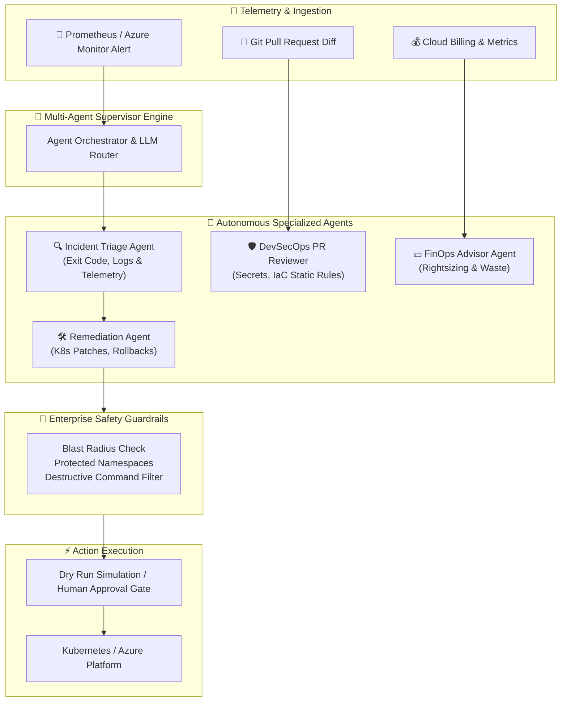
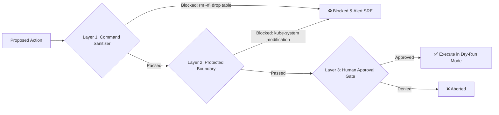

# 🤖 Agentic DevOps AI — Autonomous Multi-Agent SRE & DevSecOps Platform

[](https://github.com/shyam-codeops/agentic-devops-ai/actions)
[](https://python.org)
[](LICENSE)
[](https://github.com/shyam-codeops/agentic-devops-ai)
[](https://kubernetes.io)

An enterprise-ready **Autonomous Multi-Agent AI framework for DevOps, SRE, and DevSecOps**. Built to autonomously ingest cloud & Kubernetes telemetry, triage incidents with root-cause analysis, generate safety-validated remediation plans with rollback capabilities, scan PR diffs for security vulnerabilities, and optimize cloud infrastructure costs.

---

## 🏛️ System Architecture



---

## ✨ Key Agents & Features

| Agent | Responsibility | Key Integrations |
| :--- | :--- | :--- |
| **🔍 Incident Triage Agent** | Analyzes Kubernetes pod events, exit codes (e.g. 137 OOMKilled), and logs to calculate root-cause confidence and match operational runbooks. | CoreV1Api, Prometheus, Azure Monitor |
| **🛠️ Remediation Agent** | Formulates patch definitions (memory limits, replicas, rolling restarts) with automatic rollback command synthesis. | kubectl, Helm, Kustomize |
| **🛑 Safety Guardrails Engine** | Hard-blocks destructive commands (`rm -rf`, `delete namespace`, `delete all`), protects namespaces (`kube-system`), and validates blast radius. | Regex policy rules, OPA constraint logic |
| **🛡️ DevSecOps PR Reviewer** | Static regex + AI reasoning to block leaked credentials, tokens, AWS/Azure access keys, and permissive CIDR rules (`0.0.0.0/0`). | GitHub Actions, Git Unified Diffs |
| **💰 Cloud FinOps Advisor** | Identifies idle/unattached managed disks, recommends Spot instance migrations, and calculates monthly dollar savings. | Azure Cost Management, AWS CUR |

---

## 🚀 Quickstart & Usage

### 1. Clone & Run with Zero External Dependencies
The core engine has **zero mandatory third-party dependencies** — it uses Python standard library `dataclasses` with fallback mock intelligence so it runs out of the box anywhere:

```bash
git clone https://github.com/shyam-codeops/agentic-devops-ai.git
cd agentic-devops-ai

# Run complete test suite (11/11 tests pass)
python -m unittest discover -s tests -p "test_*.py" -v
```

### 2. Autonomous Incident Triage & Remediation
Simulate an end-to-end incident triage on a failing microservice:

```bash
python -m agentic_devops.cli triage --service payment-service --severity critical
```

**Output:**
```text
===============================================================
   [AI] AGENTIC DEVOPS AI - Autonomous Multi-Agent Platform
         DevOps | DevSecOps | Kubernetes | Cloud FinOps
===============================================================

[*] Triaging alert for service: payment-service (Severity: critical)

--- [TRIAGE] SRE ROOT CAUSE DIAGNOSIS ---
Incident ID   : INC-ALT-1042
Root Cause    : Container memory limit exceeded (OOMKilled) during high-throughput traffic spike.
Confidence    : 96.0%
Components    : deployment/payment-service, pod/payment-service-7f98c-x89p
Telemetry Findings:
  * Memory usage spiked from 420Mi to 512Mi limit in 90 seconds.
  * Exit code 137 detected in container status.
  * No CPU throttling observed prior to crash.

--- [REMEDIATION] AUTONOMOUS MITIGATION PLAN ---
Plan ID       : PLAN-INC-ALT-1042
Rollback Cmd  : kubectl rollout undo deployment/payment-service -n default
Proposed Actions:
  [1] [SAFE] config_patch -> deployment/payment-service
      Command: kubectl patch deployment payment-service -n default --patch '{"spec":{"template":{"spec":{"containers":[{"name":"payment","resources":{"limits":{"memory":"1Gi"},"requests":{"memory":"512Mi"}}}]}}}}'
      Reason : Increase memory limit from 512Mi to 1Gi to accommodate peak GC overhead and prevent OOM restarts.
  [2] [SAFE] k8s_restart -> deployment/payment-service
      Command: kubectl rollout restart deployment/payment-service -n default
      Reason : Trigger rolling restart of pods with updated resource boundaries.

Execution Status: Plan generated and waiting for engineer confirmation.
```

### 3. DevSecOps Pull Request Review
Scan pull requests or Infrastructure as Code diffs for secrets and dangerous permissions:

```bash
python -m agentic_devops.cli review-pr --repo contoso/ecommerce-platform --pr-id 142
```

### 4. Cloud FinOps Cost Optimization
Detect orphaned storage disks, oversized nodepools, and compute waste:

```bash
python -m agentic_devops.cli finops
```

---

## 🔒 Enterprise Safety Guardrails

Autonomous agents are powerful, but **must never run unchecked in production environments**. This platform implements a 3-layer safety barrier:



1. **Destructive Command Elimination**: Any proposal matching dangerous shell/kubectl patterns is instantly aborted.
2. **Namespace Isolation**: Workloads in `kube-system`, `kube-public`, and `cert-manager` cannot be modified by autonomous agents.
3. **Approval Gating & Dry-Run by Default**: Actions require engineer verification unless explicitly run in low-risk environments.

---

## ⚙️ Configuration

Set environment variables to connect live LLMs:

```bash
# OpenAI
export OPENAI_API_KEY="sk-..."
export LLM_MODEL="gpt-4o"

# Or Azure OpenAI
export AZURE_OPENAI_ENDPOINT="https://your-resource.openai.azure.com/"
export AZURE_OPENAI_API_KEY="..."
export AZURE_OPENAI_DEPLOYMENT="gpt-4o"

# Safety toggles
export DEV_AGENT_DRY_RUN="true"
export GITHUB_TOKEN="ghp_..."
```

---

## 🐳 Docker Deployment

Run containerized without installing any local dependencies:

```bash
docker build -t agentic-devops-ai:latest .
docker run --rm agentic-devops-ai:latest
```

---

## 👤 Author

**Shyam Singh**
* GitHub: [@shyam-codeops](https://github.com/shyam-codeops)
* Role: DevOps & DevSecOps Engineer

---

## 📄 License
This project is licensed under the MIT License - see the [LICENSE](LICENSE) file for details.
